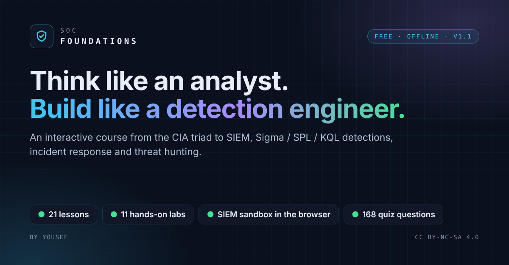

# SOC Foundations

**Think like an analyst, build like a detection engineer.**

### ▶ [Open the course](https://yousefelshetry.github.io/SOC-Foundations/)

A free, offline, interactive course for students, junior SOC analysts and aspiring detection engineers: 21 lessons and 11 hands-on labs in a single HTML file. No sign-up, no tracking, no backend — progress is saved only in your own browser.

## What's inside

- **21 interactive lessons** — the CIA triad, networking and protocols, operating systems and logging, SIEM and data onboarding, detection engineering (Sigma, Splunk SPL, Microsoft KQL, detection-as-code), alert triage, incident response, threat intelligence, threat hunting, phishing, malware, EDR, network analysis, cloud, vulnerability management, SOAR, metrics, and the career path. One fictional attack campaign runs through all of them.
- **11 hands-on labs** — a SIEM sandbox that runs right in the page (8 graded challenges), Windows and Sysmon telemetry, writing a Sigma rule and testing it with Chainsaw, Splunk Free onboarding, Atomic Red Team + ATT&CK Navigator, phishing header analysis, a full triage, and a portfolio writeup.
- **168 quiz questions**, a **126-term glossary** with instant search, a 60-second summary atop every lesson, and learning paths including a 12-hour detection-engineering fast track.

## Use it

- **Online:** [yousefelshetry.github.io/SOC-Foundations](https://yousefelshetry.github.io/SOC-Foundations/)
- **Offline:** download [`index.html`](index.html) and open it in any current browser (Chrome, Edge, Firefox, Safari). Everything works without an internet connection.

## Found an error?

[Open an issue](https://github.com/YousefElShetry/SOC-Foundations/issues) with the lesson and section number (for example “L8 · 07”). Security moves fast; corrections are welcome and credited in the changelog.

## Credits & license

Created by **Yousef**.

SOC Foundations is licensed under **[Creative Commons Attribution-NonCommercial-ShareAlike 4.0 International](https://creativecommons.org/licenses/by-nc-sa/4.0/)** — you may share and adapt it for non-commercial purposes with credit, and adaptations must use the same license. See [`LICENSE.md`](LICENSE.md). Product and tool names belong to their owners; the course's company, people and incidents are fictional, and attacker IP addresses come from reserved documentation ranges.

## Changelog

**v1.1 — November 2026**
- Quiz answers shuffle on every load; wrong answers rewritten to match the right ones in length; True/False balanced 21 / 21.
- Accuracy: NIST SP 800-61 Rev. 3 (2025), the six-level Pyramid of Pain, Event 7045's log location, and corrected cross-references.
- Detection engineering: real Sigma (including a correlation rule), SPL and KQL, detection-as-code, ADS and coverage; common schemas (CIM, ECS, ASIM, OCSF).
- Labs: fixed VM source, beacon lab and detection testing; four new labs including the in-browser SIEM; lab steps cross-checked against each tool's own documentation and source.
- Start page, 60-second summaries, glossary hints, full-text search, accessibility and contrast fixes, documentation-range IP addresses.

**v1.0** — 21 lessons, 7 labs, glossary and search.
